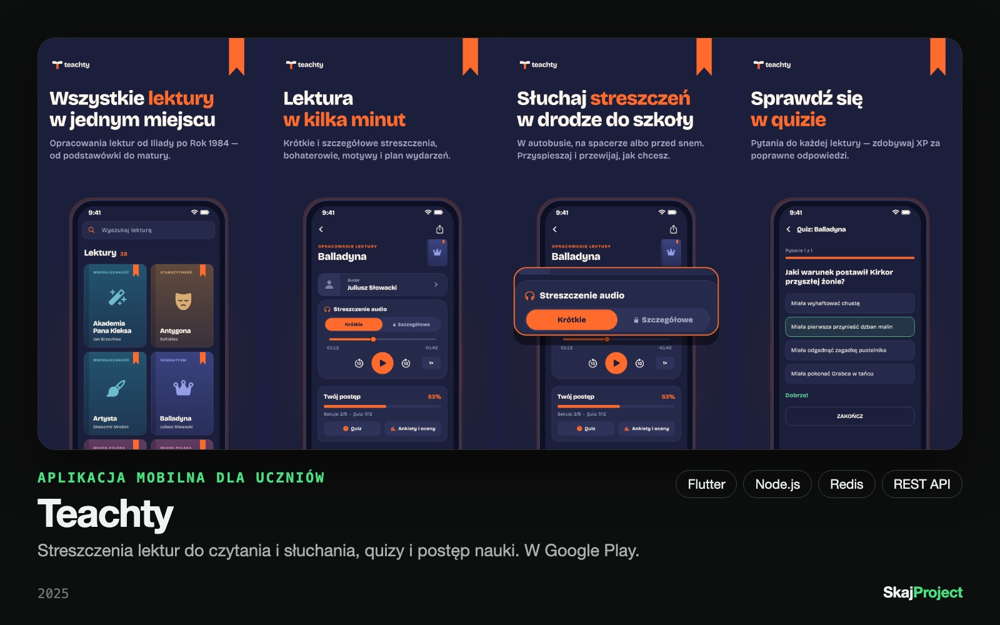

# Teachty

> 🔒 Kod źródłowy Teachty jest prywatny. To repozytorium pokazuje produkt, stack i decyzje techniczne.

**Aplikacja mobilna dla uczniów, która pomaga ogarnąć lektury szkolne.** Od podstawówki do matury: streszczenia do czytania i słuchania, quizy i postęp nauki w jednym miejscu.

[▶ Google Play](https://play.google.com/store/apps/details?id=com.skajproject.teachty) · [teachty.com](https://teachty.com)

## Co potrafi

- **Opracowania lektur**: krótkie streszczenia do szybkiej powtórki i szczegółowe do zrozumienia całości, charakterystyki bohaterów, motywy, czas i miejsce akcji, plan wydarzeń.
- **Streszczenia audio**: do słuchania w drodze do szkoły, z przewijaniem i zmianą tempa.
- **Quizy**: sprawdzenie wiedzy po lekturze.
- **XP, poziomy i seria dni nauki**: punkty za przerobione części i poprawne odpowiedzi, odznaki „Znawca” za zaliczoną lekturę.
- **Teachty Premium**: opcjonalnie, bez reklam.
- Konto przez Google lub e-mail. Aplikacja jest darmowa.

## Stack

| Warstwa | Technologie |
|---|---|
| Aplikacja | Flutter / Dart, odtwarzacz audio, zakupy w aplikacji (Premium) |
| Backend | Node.js, Express, REST API |
| Dane | MySQL, Redis |
| Usługi | Firebase (Auth, Analytics, Crashlytics, Cloud Messaging, Remote Config) |
| Wdrożenie | Własny serwer, PM2 |

## Wyzwanie techniczne: z pięciu produktów do jednego

W pewnym momencie aplikacja rozrosła się o notatki, foldery, zadania użytkowników, komentarze i ogólny czat AI, czyli w praktyce o kilka osobnych produktów naraz. Dla jednej osoby to nie do utrzymania, a użytkownik przychodził po lektury. Zdecydowałem się to wyciąć i skupić produkt na lekturach, a backend przepisać na moduły funkcjonalne (m.in. auth, books, learning, subscriptions, users, admin). Efekt: mniej kodu do utrzymania, prostsze wdrożenia i łatwiej dokładać kolejne funkcje wokół lektur.

## Autor

Piotr Woźniak · [SkajProject](https://skajproject.com), własny produkt, projekt, kod i wdrożenie.
